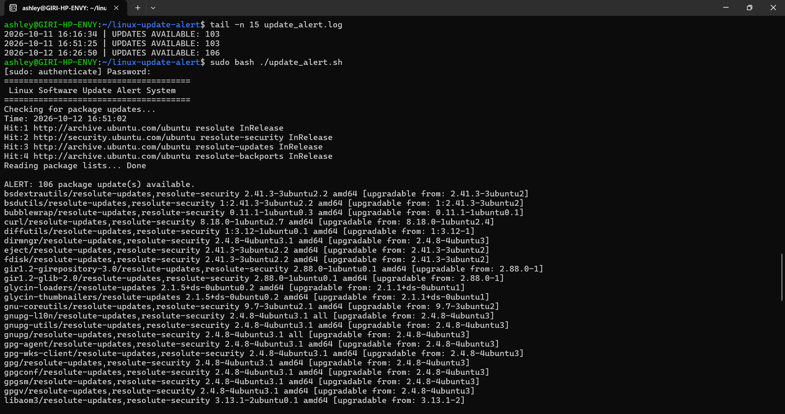

# Linux Software Update Alert System

## Overview
A Bash-based Linux automation project that checks for available Ubuntu package updates, displays an alert in the terminal, and records the results in a log file. The script can also be scheduled to run automatically using cron.

## Features
- Checks for available APT package updates.
- Displays the number of available updates.
- Lists packages that can be updated.
- Records each check result with a timestamp.
- Handles package metadata refresh failures.
- Reports available updates without installing them automatically.
- Supports daily automated checks using cron.

## Technologies Used
- Ubuntu Linux
- Bash scripting
- APT package manager
- Cron job scheduling
- Git and GitHub
- Windows Subsystem for Linux (WSL) for testing

## Requirements
- Ubuntu or another compatible Debian-based Linux distribution.
- Bash shell.
- APT package manager.
- Administrator privileges to refresh package metadata.
- Cron for scheduled execution.

## How to Run

Clone the repository and enter the project directory:

```bash
git clone https://github.com/tamilmalars/linux-update-alert-system.git
cd linux-update-alert-system
```

Make the script executable:

```bash
chmod +x update_alert.sh
```

Run the update check:

```bash
sudo ./update_alert.sh
```

The script refreshes APT package metadata, lists available package updates, and records the result in `update_alert.log`.

## Scheduled Automation Using Cron

The script can be scheduled to run automatically every day at 9:00 AM India Standard Time (IST).

The current WSL setup uses UTC, so the equivalent cron schedule is 03:30 UTC.

Edit the root user's crontab:

```bash
sudo crontab -e
```

Add the following entry:

```cron
30 3 * * * /usr/bin/bash /home/ashley/linux-update-alert/update_alert.sh > /home/ashley/linux-update-alert/cron-output.log 2>&1
```

This schedule:
- Runs the update check daily at 9:00 AM IST when WSL is running.
- Saves terminal output and errors to `cron-output.log`.
- Records timestamped check results in `update_alert.log`.

**Note:** The example paths above are specific to the development environment used for testing. Change them to match your own project directory. If WSL is stopped at the scheduled time, the job will not run automatically later to catch up.

## Safety
This script does not install, upgrade, or remove packages. It refreshes APT package metadata and reports available updates only.

## Project Status
Working prototype tested on Ubuntu 26.04.1 LTS running under Windows Subsystem for Linux (WSL). Daily cron scheduling has been configured in the development environment.

## Project Output

The screenshot below shows the Linux update alert script execution and the timestamped update-check logs.


